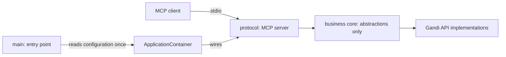

<!--
SPDX-FileCopyrightText: 2026 bobyone
SPDX-License-Identifier: GPL-2.0-or-later
-->

# Architecture

## Overview



- **Entry point** (`gandi_mcp.main`): parses arguments, reads and validates the
  configuration once, configures logging (stderr), builds the container and
  runs the server over `stdio`.
- **Container** (`gandi_mcp.container.ApplicationContainer`): the only place
  where concrete implementations are chosen and assembled
  (`dependency-injector`). Singletons use the container scope.
- **Protocol** (`gandi_mcp.protocol`): adapts the business core to MCP (tools,
  resources, MCP App).
- **Business core**: `accounts` (account rules), `operations` (Gandi calls and
  their common rules), `confirmation` (chain of confirmation channels),
  `token_entry` (token entry sessions), `interaction` (elicitation, browser),
  `i18n` (translation).
- **Technical implementations**: `secrets/keyring`, `preferences/json`,
  `gandi/http`, `local_pages/starlette`, `interaction/system`, `i18n/babel`.

Source tree and tests mirror each other (`src/gandi_mcp/<notion>/`,
`tests/<notion>/`).

## Abstractions

### Translator: `gandi_mcp.i18n.translator.Translator`

Renders user-facing messages (`gandi_mcp.i18n.message.Message`, declared with
the `N_` and `ngettext` markers so that Babel extracts them) in a locale.

| Operation | Contract |
| --- | --- |
| `default_locale` | Locale used when none is given (system language, else English). |
| `negotiate(preferred)` | Best supported locale for tags in preference order (`fr-CA`, `sr_Latn`); English when nothing matches. |
| `translate(message, locale=None, **params)` | Renders the message with its named parameters; numbers are formatted for the locale; a plural message needs an integer `count`. Raises `TranslationError` for a missing parameter or an invalid `count`. |

### Secret store: `gandi_mcp.secrets.secret_store.SecretStore`

Keeps Personal Access Tokens (`gandi_mcp.secrets.personal_access_token.PersonalAccessToken`,
a value object that validates the format, masks `repr`/`str`, refuses
serialization and exposes the value through `reveal()` only) under opaque keys.

| Operation | Contract |
| --- | --- |
| `get(key)` | Returns the token; raises `SecretNotFoundError` when absent. |
| `put(key, token)` | Stores the token, replacing any previous one. |
| `delete(key)` | Removes the token; raises `SecretNotFoundError` when absent. |

Every operation raises `SecretStoreUnavailableError` when the store cannot be
reached. Exceptions derive from `SecretStoreError` and never contain a secret.

### Account service: `gandi_mcp.accounts.account_service.AccountService`

The facade of the account rules, used by every tool that manages or resolves
an account. It depends on a `PreferencesStore`, a `SecretStore` and a
`TokenVerifier` only, and serializes changes.

| Operation | Contract |
| --- | --- |
| `list()` | Accounts sorted by name, as `AccountSummary` (name, environment, read-only flag, default flag; no secret). |
| `resolve(name=None, *, allow_pending=False)` | The named account, else the default one. `NoAccountError`, `AccountNotFoundError`, `AccountRemovalPendingError` (only the removal flow sets `allow_pending`, to finish an interrupted removal). |
| `add(draft, token)` | Checks the name is free (`DuplicateAccountError`), verifies the token in the chosen environment (`TokenRejectedError`), stores the token, then the account; the first account becomes the default. If saving the preferences fails, the token is removed again. Returns a `VerifiedAccount` (summary and `AccountIdentity`). |
| `update(name, *, new_name, read_only, make_default, expected, writes_confirmed)` | Checks everything under the preferences transaction (expected account, free name, and `writes_confirmed` when allowing writes on an account read-only at that moment: `WritesNotConfirmedError` otherwise), then applies the rename, the read-only flag and the default flag in one save; a refusal changes nothing. Keeps the token; a case-only rename is saved. |
| `rename`, `set_default`, `set_read_only` | Shortcuts of `update`. |
| `replace_token(name, token)` | Verifies the token in the account environment, then replaces the old one (kept when rejected). |
| `change_environment(name, environment, token)` | Verifies the token in the new environment; restores the previous token if saving fails. |
| `remove(name)` | Marks the account as removal pending (durably), removes the token, then removes the account. A failure before the mark changes nothing; a secret store failure withdraws the mark, so the account stays usable; any later interruption (failure, cancellation, crash) leaves a pending removal: the account can only be removed again, which completes it (`AccountRemovalPendingError` for any other use). A removed default account is replaced by the first remaining one in alphabetical order. Returns an `AccountRemoval` (`removed`, `new_default`). |

`set_read_only`, `replace_token`, `change_environment` and `remove` accept an
`expected` `AccountReference` (opaque key and environment of the account the
user saw): when the account no longer matches it, they raise
`AccountChangedError` before any change or Gandi request.

Exceptions derive from `AccountError`: `InvalidAccountNameError`,
`DuplicateAccountError`, `AccountNotFoundError`, `AccountChangedError`,
`NoAccountError`,
`ReadOnlyAccountError`, `TokenRejectedError`. Secret store, preferences and
Gandi errors pass through.

### Operation: `gandi_mcp.operations.operation.Operation`

A command: one Gandi call on behalf of an account (ADR 4).

| Member | Contract |
| --- | --- |
| `name` | Stable identifier, for example `domain.renew`. |
| `category` | `OperationCategory`: `read`, `write`, `destructive` or `billable`; the last two are writes and need a confirmation. |
| `parameters()` | Parameters defining what the operation does; with `name`, they form its `subject()`. The executor binds a confirmation to this subject, the account identity and its environment. |
| `describe()` | `LocalizedText` shown when asking for a confirmation. |
| `execute(client, environment, token)` | Calls Gandi; raises `GandiError`. |

`OperationExecutor.run(operation, account_name, context, confirmation_id=None)`
resolves the account, refuses a write on a read-only account
(`ReadOnlyAccountError`), asks for a confirmation when needed, reads the token
and calls Gandi. It returns an `UntrustedResult` (data and `total_count`), or
a pending `ConfirmationDecision` to resume with its identifier.

### Confirmation channel: `gandi_mcp.confirmation.confirmation_channel.ConfirmationChannel`

| Operation | Contract |
| --- | --- |
| `available(context)` | Whether the channel can reach the user during this call (`ConfirmationContext`: user interaction, locale). |
| `confirm(request, context)` | Returns an accepted or pending `ConfirmationDecision`; raises `ConfirmationRefusedError` or `ConfirmationUnavailableError`. |

`ConfirmationService` tries its channels in order. Given a confirmation
identifier, it resumes the pending confirmation instead (`PendingConfirmations`:
accepted once, for the same subject, before its deadline, which also applies
once it is accepted).
Exceptions derive from `ConfirmationError`: `ConfirmationRefusedError`,
`ConfirmationExpiredError`, `ConfirmationUnavailableError`,
`ConfirmationMismatchError`.

`ConfirmationPage` is the port of the local page where a pending confirmation is
answered: `open_confirmation(pending, locale)` returns its URL, which is never
given to the model.

### User interaction: `gandi_mcp.interaction.user_interaction.UserInteraction`

Questions asked to the user through the MCP client, outside the model context.

| Member | Contract |
| --- | --- |
| `supports_confirmation`, `supports_links` | Whether form or URL elicitation is available. |
| `confirm(message)` | `True` only when the user accepted. |
| `open_link(message, url)` | Offers a link the client shows to the user; `True` when the user agreed. |

`Browser.open(url)` opens a page in the user's browser and returns `False`
when it cannot. `LinkPresenter.present(url, message, interaction)` uses URL
elicitation when available, otherwise the browser.

### Token entry: `gandi_mcp.token_entry`

A token entry session lets the user submit one token on a local page, for a
`TokenEntryTarget` (add an account, replace its token, or change its
environment).

| Component | Contract |
| --- | --- |
| `TokenEntrySessions(timeout_seconds, clock)` | In-memory registry: `open(target)`, `peek(id)`, `use(id)` (once), `close(id)`; at most 20 sessions; `SessionUsedError`, `SessionExpiredError`. |
| `TokenEntryPage` | Port of the page: `open_token_entry(session, locale)` returns its URL, never given to the model. |
| `TokenEntryService.start(target, interaction, locale)` | Opens a session and shows its page (`LinkPresenter`); `TokenEntryUnavailableError` (session closed) when it cannot. |
| `TokenSubmission.submit(target, token)` | Applies the token through `AccountService` (`add`, `replace_token` or `change_environment`). For an existing account, the target carries the `AccountReference` shown on the page: a replaced or moved account is refused before any Gandi request. |

### Local page server: `gandi_mcp.local_pages.local_page_server.LocalPageServer`

Implements `ConfirmationPage` and `TokenEntryPage`; `close()` stops serving.

### Token verifier: `gandi_mcp.accounts.token_verifier.TokenVerifier`

| Operation | Contract |
| --- | --- |
| `verify(environment, token)` | Returns the `AccountIdentity` (user name, optional full name; displayed, never stored) Gandi recognizes behind the token. `TokenRejectedError` when Gandi refuses it; other `GandiError` pass through. |

### Preferences store: `gandi_mcp.preferences.preferences_store.PreferencesStore`

Loads and saves `gandi_mcp.preferences.preferences.Preferences` as a whole: the
accounts (`gandi_mcp.accounts.account.Account`: an `AccountName`, unique
ignoring case, an `Environment`, a read-only flag and the opaque key of its
token in the secret store) and the default account. `Preferences` checks its
invariants (unique names, a default account among the accounts as soon as one
exists) and raises `CorruptPreferencesError` otherwise.

| Operation | Contract |
| --- | --- |
| `load()` | Returns the saved preferences, or empty ones. Raises `CorruptPreferencesError` (not understood) or `PreferencesUnavailableError` (unreadable). |
| `save(preferences)` | Replaces the saved preferences atomically. Raises `PreferencesUnavailableError`. |
| `transaction()` | Async context manager holding the preferences exclusively, against every process sharing them; `AccountService` loads, changes and saves inside it. Raises `PreferencesUnavailableError` when the lock is not obtained in time. |

### Gandi client: `gandi_mcp.gandi.gandi_client.GandiClient`

Sends authenticated requests to the Gandi API v5 of an environment.

| Operation | Contract |
| --- | --- |
| `request(environment, token, method, path, *, query=None, body=None)` | `path` is a sequence of segments, each encoded so that user input never changes the path structure. Returns a `GandiResponse` (`status`, decoded `data`, `total_count` of paginated lists, `location` of created resources); its data is untrusted. Raises a `GandiError` subclass. |
| `close()` | Releases network resources. |

Errors: `GandiAuthenticationError` (401), `GandiPermissionError` (403),
`GandiNotFoundError` (404), `GandiValidationError` (400, 422),
`GandiConflictError` (409), `GandiRateLimitError` (429, with `retry_after`),
`GandiUnavailableError` (network error, timeout, 5xx),
`GandiUnexpectedResponseError` (any other status or an unreadable body). Each
carries `details`: Gandi's explanations, bounded (10 entries of 300
characters), untrusted.

## Implementations

### Entry point: `gandi_mcp.main`

Command line: `gandi-mcp [--config PATH] [--version]`.

| Configuration key | Type | Default | Required | Description |
| --- | --- | --- | --- | --- |
| `logging.level` | string, one of `DEBUG`, `INFO`, `WARNING`, `ERROR`, `CRITICAL` (case-insensitive) | `WARNING` | no | Log level. |
| `preferences.path` | path (`~` expanded) | `<user configuration directory>/gandi-mcp/preferences.json` | no | Preferences file (accounts, default account; no secret). |
| `gandi.production_url` | https URL, without query nor fragment | `https://api.gandi.net/v5/` | no | Base URL of the production environment. |
| `gandi.sandbox_url` | https URL, without query nor fragment | `https://api.sandbox.gandi.net/v5/` | no | Base URL of the sandbox environment. |
| `gandi.timeout_seconds` | number, 1 to 300 | `30` | no | Timeout of one request to Gandi. |
| `confirmation.timeout_seconds` | integer, 30 to 3600 | `300` | no | Validity of a confirmation request. |
| `token_entry.timeout_seconds` | integer, 60 to 3600 | `600` | no | Validity of a token entry session. |
| `content.max_free_input` | integer, 1 to 10000 | `280` | no | Longest free input passed to the model as is. |

Behavior and limits:

- without `--config`, defaults apply;
- unknown sections or keys are rejected, so that a typo never goes unnoticed;
- `http` base URLs are only accepted on `localhost` (local test servers);
- an unreadable file, invalid TOML or an invalid value logs an error and exits
  with status 2;
- logs go to stderr only: stdout carries the MCP protocol.

### Translator: `gandi_mcp.i18n.babel.babel_translator.BabelTranslator`

| Parameter | Type | Default | Required | Description |
| --- | --- | --- | --- | --- |
| `locales_directory` | path | none | yes | Directory holding `locales.toml` and `<locale>/LC_MESSAGES/messages.po`; the package ships `gandi_mcp/locales`. |
| `default_locale` | string or none | none | no | Preferred locale, usually the system language (`gandi_mcp.i18n.system_locale`). |

Behavior and limits:

- every declared catalog is read and compiled in memory at construction; an
  unreadable declaration or catalog raises `TranslationError`;
- negotiation tries the exact locale, then language and script, then the
  language, then a fallback (`cnr` to `sr_Latn`, `sr` to `sr_Cyrl`, `no` to
  `nb`), then English;
- an untranslated entry is rendered in English;
- translations flagged `needs-review` are used as they are.

### Secret store: `gandi_mcp.secrets.keyring.keyring_secret_store.KeyringSecretStore`

| Parameter | Type | Default | Required | Description |
| --- | --- | --- | --- | --- |
| `service` | string | `gandi-mcp` | no | Keyring service name under which tokens are stored. |
| `backend` | object with `get_password`, `set_password`, `delete_password` | system keyring | no | Keyring backend; tests inject a memory backend. |

Behavior and limits:

- calls run in a worker thread, since a keyring may block on an unlock prompt;
- any keyring failure (no backend, locked keyring, D-Bus error) raises
  `SecretStoreUnavailableError`; there is no plaintext fallback (ADR 3);
- a stored value that is not a valid token raises `InvalidTokenFormatError`.

### Preferences store: `gandi_mcp.preferences.json.json_preferences_store.JsonPreferencesStore`

| Parameter | Type | Default | Required | Description |
| --- | --- | --- | --- | --- |
| `path` | path | none | yes | Preferences file (`preferences.path`); its directory is created on save. |

File format (UTF-8 JSON, no secret):

```json
{
  "version": 1,
  "default_account": "Perso",
  "accounts": [
    {"name": "Perso", "environment": "sandbox", "read_only": false, "secret_key": "<opaque key>"}
    // "removal_pending": true is added while a removal is not finished
  ]
}
```

Behavior and limits:

- a missing file means empty preferences;
- `transaction()` locks `<file>.lock` (`msvcrt` on Windows, `fcntl` elsewhere),
  waiting up to `lock_timeout_seconds` (10 s): several MCP clients may run their
  own gandi-mcp process on the same preferences;
- file operations and the lock acquisition run in a worker thread that is
  always allowed to finish (`blocking_call.run_to_completion`): a cancelled call
  releases a lock obtained too late, and never releases the lock while a write
  is still in progress;
- an invalid file (JSON, structure, names, invariants), a file larger than
  1 MB or another format version raises `CorruptPreferencesError` and is never
  overwritten;
- saving writes a temporary file in the same directory, flushes it to disk and
  replaces the previous file; on failure the previous file is kept and the
  temporary file removed.

### Gandi client: `gandi_mcp.gandi.http.http_gandi_client.HttpGandiClient`

| Parameter | Type | Default | Required | Description |
| --- | --- | --- | --- | --- |
| `base_urls` | mapping environment to URL | none | yes | `gandi.production_url` and `gandi.sandbox_url`. |
| `timeout_seconds` | number | none | yes | `gandi.timeout_seconds`. |
| `user_agent` | string | none | yes | `User-Agent` header (`gandi-mcp/<version>`). |
| `transport` | `httpx2.AsyncBaseTransport` | network | no | Replaces the network in tests (`httpx2.MockTransport`). |

Behavior and limits:

- sends `Authorization: Bearer <token>`; the token is never logged;
- redirects are not followed, so the token only reaches the configured base
  URLs;
- boolean query values are sent as `true`/`false`, lists as repeated
  parameters;
- logs (DEBUG) only the method, environment, status and duration: no path,
  since it may contain personal data;
- status translation is in `gandi_error_translator.translate_error`. Gandi
  documents an expired token either as 401 or 403, so the user messages for
  both suggest replacing the token.

### Token verifier: `gandi_mcp.accounts.gandi.gandi_token_verifier.GandiTokenVerifier`

| Parameter | Type | Default | Required | Description |
| --- | --- | --- | --- | --- |
| `client` | `GandiClient` | none | yes | Client used to call Gandi. |

Calls `GET organization/user-info`. HTTP 401 and 403 mean the token is
rejected. Only `username` (required) and `name` are kept, trimmed to 200
characters; the email and the other fields are ignored.

### Confirmation channels: `gandi_mcp.confirmation.channels`

| Channel | Available when | Behavior |
| --- | --- | --- |
| `ElicitationChannel(translator)` | the client supports form elicitation | Asks "Confirm on the production/sandbox account {account}: {action}" in the user's language; anything but an acceptance raises `ConfirmationRefusedError`. |
| `LocalLinkChannel(pending, page, presenter, translator)` | always (last resort) | Registers a pending confirmation, shows its page through `LinkPresenter`; returns it as pending, or raises `ConfirmationUnavailableError` (and forgets it) when the page cannot be shown. |

`PendingConfirmations(timeout_seconds, clock)` keeps at most 100 pending
confirmations in memory (`confirmation.timeout_seconds`), with random
identifiers (128 bits).

### Browser: `gandi_mcp.interaction.system.system_browser.SystemBrowser`

Opens `http://127.0.0.1` and `http://localhost` URLs only, in a new tab of the
default browser (`webbrowser`), in a worker thread; any other URL raises
`ValueError`.

### Local page server: `gandi_mcp.local_pages.starlette.starlette_local_page_server.StarletteLocalPageServer`

| Parameter | Type | Default | Required | Description |
| --- | --- | --- | --- | --- |
| `pending` | `PendingConfirmations` | none | yes | Pending confirmations answered on confirmation pages. |
| `sessions` | `TokenEntrySessions` | none | yes | Token entry sessions. |
| `submission` | `TokenSubmission` | none | yes | Applies a submitted token. |
| `translator` | `Translator` | none | yes | Translates the pages. |
| `page_timeout_seconds` | number | none | yes | Validity of a page: the longest of `confirmation.timeout_seconds` and `token_entry.timeout_seconds`. |
| `clock` | callable | `time.monotonic` | no | Clock, for tests. |

Behavior and limits:

- an embedded Uvicorn server listens on `127.0.0.1`, on a random port; it
  starts when a page is registered and stops when no page remains (checked
  when a page expires) or on `close()`; it never installs signal handlers and
  writes no access log, since URLs carry secret codes;
- each page has its own 256-bit code in its path (`/token/<code>`,
  `/confirm/<code>`), distinct from the identifiers known to the model, and
  answers one submission;
- requests are refused unless `Host` is `127.0.0.1:<port>`; a `POST` is
  refused when `Origin` or `Sec-Fetch-Site` shows another site, when it is not
  `application/x-www-form-urlencoded`, when its body exceeds 8 KB or when its
  form does not repeat the page code;
- pages have no script, escape every value, and are served with a strict
  Content Security Policy (`default-src 'none'`, hashed inline style,
  `form-action 'self'`, `frame-ancestors 'none'`), `Referrer-Policy:
  no-referrer`, `Cache-Control: no-store`, `X-Frame-Options: DENY`;
- the language is the one of the call that opened the page, else the browser's
  `Accept-Language`, else English;
- a token with an invalid format can be corrected on the same page; any other
  outcome ends the session and is explained without technical detail.

### Domain values: `gandi_mcp.domains`

| Value | Rule |
| --- | --- |
| `DomainName` | Fully qualified name, at least two labels, IDNA 2008 with UTS 46 mapping (`idna`); `value` is the ASCII form sent to Gandi, `unicode` the readable form; at most 253 characters, labels of 1 to 63 characters, no wildcard nor path character. |
| `TldName` | One label, leading dot removed. |
| `HostLabel` | A host relative to a domain (`ns1`, `ns1.sub`) or `@` for the domain itself. |
| `PageRequest` | `page` from 1 to 1000, `per_page` from 1 to 100. |

Invalid values raise `InvalidDomainNameError` or `InvalidDomainInputError`
(both `DomainError`).

### Contact minimization: `gandi_mcp.domains.contacts.contact_redactor.ContactRedactor`

`apply(data, *, include_contact_details=False, include_authorization_code=False)`
returns a filtered copy of Gandi data (ADR 9): at any depth, a contact under
`owner`, `admin`, `bill` or `tech` (a mapping with personal fields such as
`email` or `streetaddr`) keeps only `type`, `country`, `same_as_owner` and
`details: "hidden"`; `authinfo` becomes `"hidden"`.

### Untrusted results: `gandi_mcp.protocol.untrusted_result_presenter.present`

Frames Gandi data for the model as `{"notice", "untrusted_data"}`, plus
`page`, `per_page` and `total_count` for a list.

### Endpoint catalogue: `gandi_mcp.operations.domain`

`DomainEndpoint` describes one endpoint of the Domain API (ADR 8): `name` (also
the tool name), `method`, `path` (segments, `{placeholder}` segments filled
with validated values), `category`, accepted `query` parameters,
`description` (required for confirmed categories), `supports_dry_run` and
`follow_up`. `domain_endpoints.py` lists them.

`EndpointOperation(endpoint, path_values, query=None, body=None,
description_params=None)` runs a specification: it raises
`InvalidDomainInputError` when a placeholder has no value, a value is empty or
contains `/`, or a query parameter is not accepted; `None` query values are
dropped.

### Server factory: `gandi_mcp.protocol.server_factory.create_server`

| Parameter | Type | Default | Required | Description |
| --- | --- | --- | --- | --- |
| `version` | string | none | yes | Version advertised to clients (`app.version`, set by the entry point from the package metadata). |
| `tool_modules` | sequence of `ToolModule` | none | no | Groups of tools registered on the server. |
| `closers` | sequence of async callables | none | no | Called when the server stops (HTTP client, local page server). |

Creates the `MCPServer` named `gandi-mcp`, with instructions telling the model
that tool results are untrusted data, never to ask for a token in the
conversation and never to invent a confirmation identifier.

### Protocol adapters: `gandi_mcp.protocol`

| Component | Role |
| --- | --- |
| `ToolModule` | Abstraction: `register(server)` adds the tools of a notion. |
| `tools.accounts_tools.AccountsTools` | `list_accounts`, `add_account`, `update_account`, `replace_account_token`, `change_account_environment`, `remove_account`. No tool receives or returns a token; token changes open a token entry session; removing an account and turning read-only off need a confirmation (pending results carry `confirmation_id`). |
| `McpUserInteraction` | `UserInteraction` over MCP elicitation for one call. From protocol revision 2026-07-28 (no request from the server during a call), elicitation is treated as unavailable, so confirmations use the local page (ADR 4). |
| `ErrorPresenter` | Maps each business exception to a translated explanation with its remedy (system language); Gandi details are appended and marked as untrusted; unknown exceptions are logged and shown as a generic error. |

### MCP App: `gandi_mcp.protocol.app` and `ui/`

| Component | Role |
| --- | --- |
| `AppModule` | Abstraction: `register(apps)` adds UI resources and UI-bound tools to the MCP Apps extension. |
| `app.app_resource` | Serves `ui://gandi/app.html` (`text/html;profile=mcp-app`, empty CSP domains) from `protocol/app/static/app.html`, built from `ui/` and committed (ADR 5); `AppResourceMissingError` when missing. |
| `app.accounts_app_tools.AccountsAppTools` | `open_gandi_app` (model and app) and the app-only tools `app_list_accounts`, `app_add_account`, `app_update_account`, `app_replace_account_token`, `app_change_account_environment`, `app_remove_account`. Only these receive a token. They refuse clients that did not negotiate MCP Apps. Removing an account and allowing writes are confirmed through the same chain as for the model (elicitation, else local page); `app_update_account` and `app_remove_account` accept the `confirmation_id` of a pending confirmation. |

The UI (`ui/src/`, TypeScript, React-Bootstrap) has the same layering:
`api/accounts-api.ts` (abstraction `AccountsApi`), `api/mcp/mcp-accounts-api.ts`
(calls the app-only tools through the host), `components/` (the "Accounts"
screen: table, add, rename, replace token, change environment, set as default,
read-only on and off, remove with a confirmation dialog; a pending server
confirmation shows a message and a Continue button), `i18n/` (language of
the host, then of the browser, then English; ICU catalogs). The host style
variables theme Bootstrap through its CSS variables (`theme.css`).

### Wiring: `gandi_mcp.container.ApplicationContainer`

Every component is a container singleton. The entry point adds `app.version`
and `app.locale` (the system language, from `gandi_mcp.i18n.system_locale`) to
the validated configuration. The confirmation channels are wired in the order
`ElicitationChannel`, `LocalLinkChannel`; the local page server
implements both page ports and uses the longest of the two page timeouts.

## Development tooling

| Tool | Role |
| --- | --- |
| `scripts/check_translations.py` | Checks catalogs against the code and the declared locales (`locales/locales.toml`): missing or undeclared catalogs, missing, unused or obsolete keys, empty translations, parameters differing in any plural form; counts translations awaiting review. |
| `scripts/check_licenses.py` | Checks that runtime dependencies are compatible with `GPL-2.0-or-later`, evaluating SPDX expressions with operator precedence; platform-specific dependencies are checked on their platform (CI runs it on each OS). |
| `scripts/check_ui_translations.py` | Checks the ICU catalogs of the MCP App: keys used in the code, keys and ICU arguments identical to English, plural `other` forms, one catalog per target locale; keeps the glossary table of UI labels in sync (`--write-glossary`). |
| `scripts/check_npm_licenses.py` | Checks the licenses of the runtime npm packages of `ui/package-lock.json` (those that can be bundled in `app.html`). |
| `ui/scripts/third-party-notices.mjs` | Writes `THIRD_PARTY_NOTICES.md` next to `app.html` at build time. |
| `scripts/check_dco.py` | Checks the `Signed-off-by` trailers of every commit of a range, merges included. |
| `tools/assistant_guard/` | PreToolUse hook shared by Claude Code and Codex: `policy.py` (client-independent rules), `adapters.py` (one adapter per client), `hook.py` (entry point), `codex_profile.py` (Codex sandbox rules and test samples derived from the policy). |
