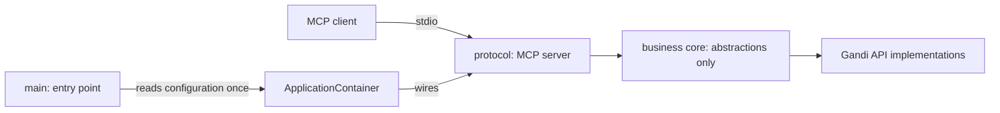

<!--
SPDX-FileCopyrightText: 2026 bobyone
SPDX-License-Identifier: GPL-2.0-or-later
-->

# Architecture

## Overview

- **Entry point** (`gandi_mcp.main`): parses arguments, reads and validates the
  configuration once, configures logging (stderr), builds the container and
  runs the server over `stdio`.
- **Container** (`gandi_mcp.container.ApplicationContainer`): the only place
  where concrete implementations are chosen and assembled
  (`dependency-injector`). Singletons use the container scope.
- **Protocol** (`gandi_mcp.protocol`): adapts the business core to MCP (tools,
  resources, MCP App).
- **Business core** and **Gandi implementations**: added per batch, each notion
  in its own directory, from the general abstraction to its implementations.

Source tree and tests mirror each other (`src/gandi_mcp/<notion>/`,
`tests/<notion>/`).

## Abstractions

None yet: they are introduced by the validated design of each batch.

## Implementations

### Entry point: `gandi_mcp.main`

Command line: `gandi-mcp [--config PATH] [--version]`.

| Configuration key | Type | Default | Required | Description |
| --- | --- | --- | --- | --- |
| `logging.level` | string, one of `DEBUG`, `INFO`, `WARNING`, `ERROR`, `CRITICAL` (case-insensitive) | `WARNING` | no | Log level. |
| `preferences.path` | path (`~` expanded) | `<user configuration directory>/gandi-mcp/preferences.json` | no | Preferences file (accounts, default account; no secret). |
| `gandi.production_url` | https URL, without query nor fragment | `https://api.gandi.net/v5/` | no | Base URL of the production environment. |
| `gandi.sandbox_url` | https URL, without query nor fragment | `https://api.sandbox.gandi.net/v5/` | no | Base URL of the sandbox environment. |
| `gandi.timeout_seconds` | number, 1 to 300 | `30` | no | Timeout of one request to Gandi. |
| `confirmation.timeout_seconds` | integer, 30 to 3600 | `300` | no | Validity of a confirmation request. |
| `token_entry.timeout_seconds` | integer, 60 to 3600 | `600` | no | Validity of a token entry session. |
| `content.max_free_input` | integer, 1 to 10000 | `280` | no | Longest free input passed to the model as is. |

Behavior and limits:

- without `--config`, defaults apply;
- unknown sections or keys are rejected, so that a typo never goes unnoticed;
- `http` base URLs are only accepted on `localhost` (local test servers);
- an unreadable file, invalid TOML or an invalid value logs an error and exits
  with status 2;
- logs go to stderr only: stdout carries the MCP protocol.

### Server factory: `gandi_mcp.protocol.server_factory.create_server`

| Parameter | Type | Default | Required | Description |
| --- | --- | --- | --- | --- |
| `version` | string | none | yes | Version advertised to clients (`app.version`, set by the entry point from the package metadata). |

Creates the `MCPServer` named `gandi-mcp`, with instructions telling the model
that tool results are untrusted data.

## Development tooling

| Tool | Role |
| --- | --- |
| `scripts/check_translations.py` | Checks catalogs against the code and the declared locales (`locales/locales.toml`): missing or undeclared catalogs, missing, unused or obsolete keys, empty translations, parameters differing in any plural form; counts translations awaiting review. |
| `scripts/check_licenses.py` | Checks that runtime dependencies are compatible with `GPL-2.0-or-later`, evaluating SPDX expressions with operator precedence; platform-specific dependencies are checked on their platform (CI runs it on each OS). |
| `scripts/check_dco.py` | Checks the `Signed-off-by` trailers of every commit of a range, merges included. |
| `tools/assistant_guard/` | PreToolUse hook shared by Claude Code and Codex: `policy.py` (client-independent rules), `adapters.py` (one adapter per client), `hook.py` (entry point), `codex_profile.py` (Codex sandbox rules and test samples derived from the policy). |
